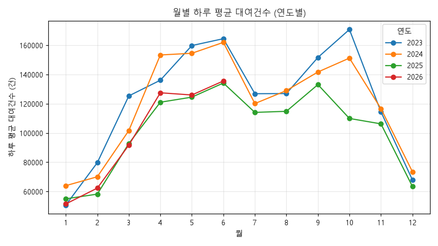
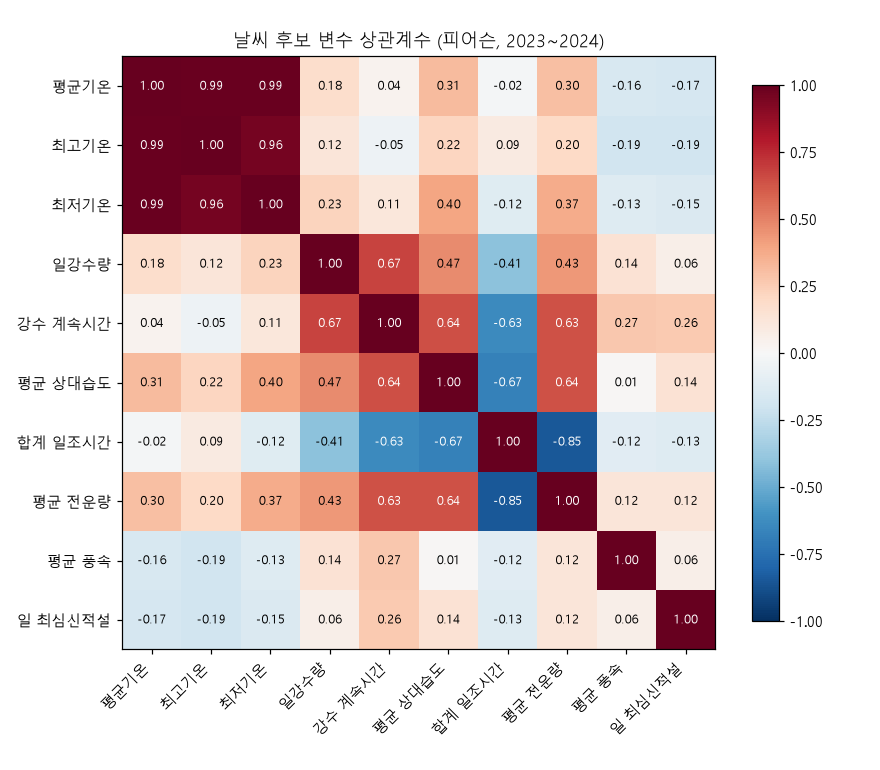
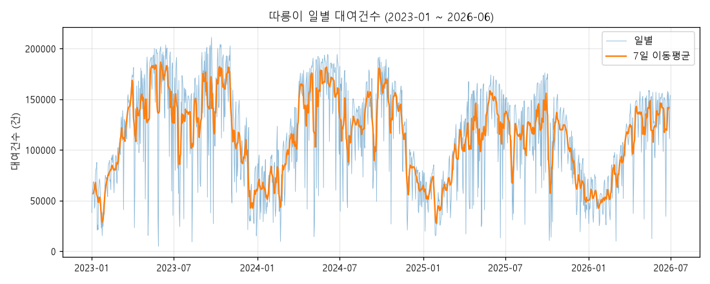
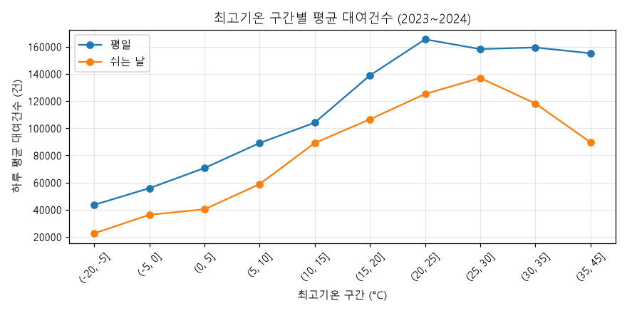
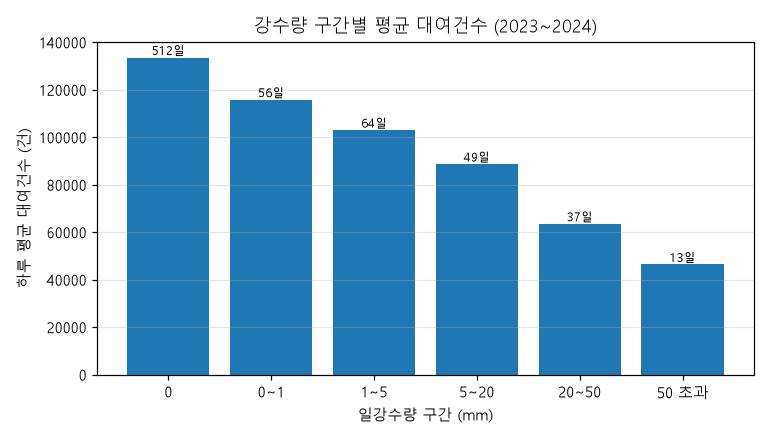
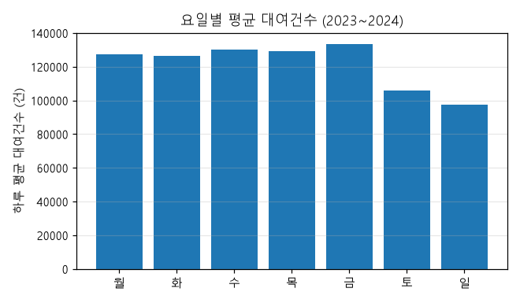

# 탐색(EDA) 결과 보고서

생성 시각: 2026-10-13 21:35

이 파일은 `py eda/run_all.py`가 자동으로 만든다. 직접 고치지 말고, 판단은 `eda/DECISIONS.md`에 적는다.

### 실행 환경

- Python 3.12.3 (C:\Users\PC2402\AppData\Local\Programs\Python\Python312\python.exe)
- OS: Windows-10-10.0.19045-SP0
- CPU: Intel64 Family 6 Model 142 Stepping 11, GenuineIntel
- pandas 3.0.6
- numpy 2.5.4
- sklearn 1.9.1
- matplotlib 3.11.2

## 1. 강수·적설 빈칸 점검

ASOS 원본 1,277일 기준. build_dataset.py는 강수량·강수 계속시간·신적설의 빈칸을 0으로 채운다.
아래 결과로 그 처리가 맞는지 판단한다.

### 1-1. 강수량 빈칸과 강수 계속시간 빈칸이 같은 날인가

| 강수량 \ 강수시간 | 강수시간 값 있음 | 강수시간 빈칸 |
| --- | --- | --- |
| 강수량 값 있음 | 528 | 1 |
| 강수량 빈칸 | 3 | 745 |

### 1-2. 강수량이 빈칸인 날에 비가 왔다는 다른 기록이 있는가

|  | 날 수 |
| --- | --- |
| 강수량(sumRn)이 빈칸인 날 | 748 |
|   └ 그중 일기현상에 비·눈 기록이 있는 날 | 1 |
|   └ 그중 9-9강수(n99Rn) > 0 인 날 | 58 |
|   └ 그중 1시간 최다강수량(hr1MaxRn) > 0 인 날 | 0 |
|   └ 그중 강수 계속시간(sumRnDur) > 0 인 날 | 1 |
| 참고: 강수량이 0.0으로 기록된 날 | 155 |

- 일기현상 키워드: 비 관련 ('비', '소나기', '우박'), 눈 관련 ('눈',) (현상 이름에 이 글자가 들어가면 해당으로 봄)
- 9-9강수는 오전 9시~다음날 오전 9시 합계라서, 하루(0~24시) 강수량과 기간이 다르다.
- 근거가 겹치는 날의 상세 목록: `tables/01_rain_blank_but_precip_signs.csv`

### 1-3. 신적설이 빈칸인 날에 눈이 왔다는 기록이 있는가

|  | 날 수 |
| --- | --- |
| 신적설(ddMefs)이 빈칸인 날 | 1,228 |
|   └ 그중 일기현상에 눈 기록이 있는 날 | 54 |
|   └ 그중 최심적설(ddMes, 쌓여 있던 눈) > 0 인 날 | 33 |
| 참고: 신적설이 0.0으로 기록된 날 | 0 |

- 상세 목록: `tables/01_snow_blank_but_snow_signs.csv`

### 1-4. 0으로 채우지 않는 변수의 빈칸

|  | 빈칸 수 |
| --- | --- |
| avg_temp | 0 |
| max_temp | 0 |
| min_temp | 0 |
| humidity | 0 |
| sunshine_hr | 5 |
| cloud | 0 |
| wind_ms | 5 |

- 빈칸이 있는 날짜: `tables/01_other_blank_days.csv` (모델링 때 학습 기간 중앙값으로 채울 예정)

### 1-5. 일기현상에 기록된 현상 이름 (상위 15개)

| 현상 | 기록된 날 수 |
| --- | --- |
| 박무 | 480 |
| 비 | 413 |
| 연무 | 212 |
| 눈 | 91 |
| 안개비 | 71 |
| 소나기 | 56 |
| 황사 | 37 |
| 진눈깨비 | 37 |
| 햇무리 | 36 |
| 안개 | 14 |
| 싸락눈 | 5 |
| 달무리 | 4 |
| 무지개 | 4 |
| 싸락우박 | 4 |
| 우박 | 3 |

> 판단 메모: 결과를 보고 `eda/DECISIONS.md`의 1번 항목에 직접 적는다.

## 2. 데이터 기본 통계

기간: 2023-01-01 ~ 2026-06-30, 1,277일 (하루 1행)

### 2-1. 변수별 통계 (강수·적설은 빈칸을 0으로 채운 뒤의 값)

|  | 개수 | 빈칸 | 최솟값 | 최댓값 | 평균 | 중앙값 |
| --- | --- | --- | --- | --- | --- | --- |
| 대여건수 (rentals) | 1,277 | 0 | 4,992.0 | 211,000.0 | 112,848.1 | 115,085.0 |
| 평균기온 (avg_temp) | 1,277 | 0 | -14.7 | 32.8 | 13.9 | 15.1 |
| 최고기온 (max_temp) | 1,277 | 0 | -8.2 | 38.0 | 18.7 | 20.5 |
| 최저기온 (min_temp) | 1,277 | 0 | -17.3 | 29.3 | 9.8 | 10.6 |
| 일강수량 (rain_mm) | 1,277 | 0 | 0.0 | 128.8 | 3.7 | 0.0 |
| 강수 계속시간 (rain_hr) | 1,277 | 0 | 0.0 | 24.0 | 2.6 | 0.0 |
| 평균 상대습도 (humidity) | 1,277 | 0 | 22.9 | 99.1 | 64.6 | 65.0 |
| 합계 일조시간 (sunshine_hr) | 1,272 | 5 | 0.0 | 13.5 | 6.3 | 6.9 |
| 평균 전운량 (cloud) | 1,277 | 0 | 0.0 | 10.0 | 4.7 | 4.6 |
| 평균 풍속 (wind_ms) | 1,272 | 5 | 1.1 | 6.3 | 2.3 | 2.2 |
| 일 최심신적설 (new_snow_cm) | 1,277 | 0 | 0.0 | 19.3 | 0.1 | 0.0 |

### 2-2. 연도별 공휴일·쉬는 날 수

| year | 일수 | 공휴일 | 주말 | 쉬는날 |
| --- | --- | --- | --- | --- |
| 2023 | 365 | 18 | 105 | 118 |
| 2024 | 366 | 19 | 104 | 120 |
| 2025 | 365 | 19 | 104 | 121 |
| 2026 | 181 | 12 | 52 | 61 |
| 전체 | 1,277 | 68 | 365 | 420 |

### 2-3. 단계별 학습·평가 기간

| 단계 | 학습 기간 | 학습 일수 | 평가 기간 | 평가 일수 |
| --- | --- | --- | --- | --- |
| tune | 2023-01-01 ~ 2023-12-31 | 365 | 2024-01-01 ~ 2024-12-31 | 366 |
| test_a | 2023-01-01 ~ 2024-12-31 | 731 | 2025-01-01 ~ 2025-12-31 | 365 |
| test_b | 2023-01-01 ~ 2025-12-31 | 1,096 | 2026-01-01 ~ 2026-06-30 | 181 |

## 3. 연도별 대여 수준 변화

원인(요금, 대여소·자전거 수 등)은 이 데이터에 없다. 여기서는 변화가 있는지만 확인한다.

### 3-1. 연도별 하루 평균 (2026년은 1~6월만 있으므로 계절 차이가 섞임)

| year | 일수 | 하루 평균 | 하루 중앙값 |
| --- | --- | --- | --- |
| 2023 | 365 | 123,028 | 131,981 |
| 2024 | 366 | 119,808 | 123,842 |
| 2025 | 365 | 102,392 | 108,852 |
| 2026 | 181 | 99,331 | 102,124 |

### 3-2. 반기별 하루 평균

| half | 일수 | 하루 평균 |
| --- | --- | --- |
| 2023-상반기 | 181 | 119,652 |
| 2023-하반기 | 184 | 126,349 |
| 2024-상반기 | 182 | 117,655 |
| 2024-하반기 | 184 | 121,937 |
| 2025-상반기 | 181 | 97,930 |
| 2025-하반기 | 184 | 106,781 |
| 2026-상반기 | 181 | 99,331 |

### 3-3. 같은 달끼리 비교: 전년 같은 달 대비 변화율(%)

| month | 2024 vs 2023 (%) | 2025 vs 2024 (%) | 2026 vs 2025 (%) |
| --- | --- | --- | --- |
| 1 | 26.2 | -14.1 | -6.4 |
| 2 | -12.1 | -16.9 | 7.1 |
| 3 | -18.9 | -8.7 | -1.2 |
| 4 | 12.7 | -21.1 | 5.3 |
| 5 | -3.3 | -19.4 | 1.2 |
| 6 | -1.5 | -17.2 | 1.1 |
| 7 | -5.3 | -5.0 |  |
| 8 | 1.6 | -11.0 |  |
| 9 | -6.6 | -6.1 |  |
| 10 | -11.5 | -27.3 |  |
| 11 | 1.9 | -8.9 |  |
| 12 | 8.3 | -13.7 |  |

### 3-4. 조건을 맞춘 비교: 평일이면서 비가 오지 않은 날만

| year | 해당 일수 | 하루 평균 |
| --- | --- | --- |
| 2023 | 175 | 144,539 |
| 2024 | 175 | 142,525 |
| 2025 | 175 | 122,984 |
| 2026 | 90 | 111,082 |

월 × 연도 표: `tables/03_calm_days_month_by_year.csv`

### 3-5. 연도별 날씨 요약 (날씨 차이로 설명될 수 있는지 참고)

| year | 평균_최고기온 | 강수1mm이상_일수 | 연강수량 | 신적설_있는날 | 일수 |
| --- | --- | --- | --- | --- | --- |
| 2023 | 18.8 | 86 | 1,598.8 | 9 | 365 |
| 2024 | 19.5 | 82 | 1,311.4 | 16 | 366 |
| 2025 | 18.7 | 84 | 1,582.4 | 19 | 365 |
| 2026 | 16.5 | 29 | 293.9 | 5 | 181 |

> 판단 메모: 수준 변화가 있다고 보는지, 그렇다면 계획서에 어떻게 쓸지 `eda/DECISIONS.md`의 3번 항목에 적는다.

## 4. 날씨 후보 변수 사이의 상관

자료: 2023~2024년 731일 (시험 기간 제외)

### 4-1. |상관계수| ≥ 0.8 인 변수 쌍 (피어슨)

| 변수 1 | 변수 2 | 상관계수 |
| --- | --- | --- |
| 평균기온 | 최저기온 | 0.99 |
| 평균기온 | 최고기온 | 0.99 |
| 최고기온 | 최저기온 | 0.96 |
| 합계 일조시간 | 평균 전운량 | -0.85 |

### 4-2. |상관계수| ≥ 0.8 인 변수 쌍 (스피어먼)

| 변수 1 | 변수 2 | 상관계수 |
| --- | --- | --- |
| 평균기온 | 최저기온 | 0.99 |
| 평균기온 | 최고기온 | 0.99 |
| 최고기온 | 최저기온 | 0.95 |
| 일강수량 | 강수 계속시간 | 0.87 |
| 합계 일조시간 | 평균 전운량 | -0.84 |

### 4-3. 참고: 각 날씨 변수와 대여건수의 스피어먼 상관

|  | 대여건수와의 스피어먼 상관 |
| --- | --- |
| 평균기온 | 0.56 |
| 최고기온 | 0.62 |
| 최저기온 | 0.50 |
| 일강수량 | -0.39 |
| 강수 계속시간 | -0.41 |
| 평균 상대습도 | -0.21 |
| 합계 일조시간 | 0.42 |
| 평균 전운량 | -0.18 |
| 평균 풍속 | -0.16 |
| 일 최심신적설 | -0.27 |

- 전체 상관표: `tables/04_corr_pearson.csv`, `tables/04_corr_spearman.csv`
- 기준값 0.8는 관례적인 값이다. 다른 기준을 쓰려면 이 파일의 THRESHOLD를 바꾼다.

> 판단 메모: 함께 넣지 않을 변수 쌍과 그 이유를 `eda/DECISIONS.md`의 4번 항목에 적는다.

## 5. 날씨 변수 조합별 예측 오차 (조정 단계)

- 학습: 2023년 365일 → 평가: 2024년 366일
- 모델: 랜덤 포레스트 기본 설정(트리 300개), 난수 시드 5개 반복
- 모든 조합에 달력 변수 6개가 함께 들어간다.
- 설정값 튜닝 전 결과이므로 조합 사이의 상대 비교로만 사용한다.

| 조합 | 날씨 변수 수 | MAE 평균 | MAE 표준편차 | 소요 시간(초) | 최저 대비 차이(%) |
| --- | --- | --- | --- | --- | --- |
| A. 후보 10개 전부 | 10 | 11,077.2 | 33.9 | 2.3 | 0.0 |
| B. 평균기온 제외 (9개) | 9 | 11,075.7 | 35.6 | 2.5 | 0.0 |
| C. 전운량 제외 (9개) | 9 | 11,173.6 | 33.4 | 2.2 | 0.9 |
| D. 평균기온·전운량 제외 (8개, 현재 가안) | 8 | 11,236.6 | 29.2 | 2.1 | 1.5 |
| E. 평균기온만 + 전운량 제외 (7개) | 7 | 11,975.9 | 23.8 | 2.1 | 8.1 |
| F. 최고기온만 + 전운량 제외 (7개) | 7 | 11,969.1 | 52.0 | 2.1 | 8.1 |
| 참고. 날씨 없음 (달력만) | 0 | 25,398.4 | 79.5 | 2.0 | 129.3 |

### 조합 구성

- **A. 후보 10개 전부**: avg_temp, max_temp, min_temp, rain_mm, rain_hr, humidity, sunshine_hr, cloud, wind_ms, new_snow_cm
- **B. 평균기온 제외 (9개)**: max_temp, min_temp, rain_mm, rain_hr, humidity, sunshine_hr, cloud, wind_ms, new_snow_cm
- **C. 전운량 제외 (9개)**: avg_temp, max_temp, min_temp, rain_mm, rain_hr, humidity, sunshine_hr, wind_ms, new_snow_cm
- **D. 평균기온·전운량 제외 (8개, 현재 가안)**: max_temp, min_temp, rain_mm, rain_hr, humidity, sunshine_hr, wind_ms, new_snow_cm
- **E. 평균기온만 + 전운량 제외 (7개)**: avg_temp, rain_mm, rain_hr, humidity, sunshine_hr, wind_ms, new_snow_cm
- **F. 최고기온만 + 전운량 제외 (7개)**: max_temp, rain_mm, rain_hr, humidity, sunshine_hr, wind_ms, new_snow_cm
- **참고. 날씨 없음 (달력만)**: (없음)

> 판단 메모: `eda/DECISIONS.md`에 미리 적어 둔 선택 규칙에 따라 최종 조합을 고르고 그 이유를 5번 항목에 적는다.

## 6. 탐색 그림

| temp_bin | 평균_평일 | 평균_쉬는날 | 일수_평일 | 일수_쉬는날 |
| --- | --- | --- | --- | --- |
| (-20, -5] | 43,554 | 22,583 | 4 | 2 |
| (-5, 0] | 55,790 | 36,223 | 12 | 3 |
| (0, 5] | 70,648 | 40,271 | 45 | 26 |
| (5, 10] | 89,020 | 58,815 | 69 | 34 |
| (10, 15] | 104,052 | 89,090 | 46 | 14 |
| (15, 20] | 138,763 | 106,493 | 52 | 28 |
| (20, 25] | 165,344 | 125,112 | 84 | 44 |
| (25, 30] | 158,187 | 136,951 | 95 | 43 |
| (30, 35] | 159,353 | 118,115 | 80 | 43 |
| (35, 45] | 155,103 | 89,614 | 6 | 1 |

| rain_bin | 일수 | 하루 평균 |
| --- | --- | --- |
| 0 | 512 | 133,559 |
| 0~1 | 56 | 115,785 |
| 1~5 | 64 | 102,979 |
| 5~20 | 49 | 88,681 |
| 20~50 | 37 | 63,513 |
| 50 초과 | 13 | 46,370 |

